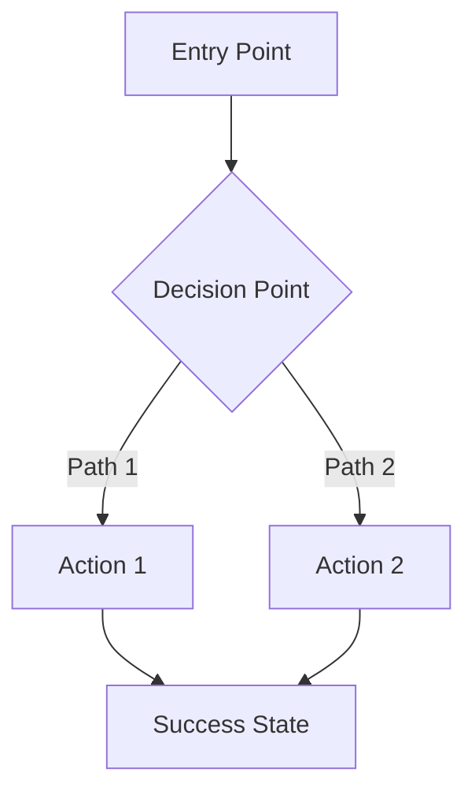

# UXRD: [Feature Name] UX Requirements

## Overview

### One-line Summary
[Describe the user experience goal in one line]

### Purpose
[Explain what user problem this UX solution addresses and how it improves user experience]

### Related Documents
- **PRD**: [Link to Product Requirements Document]
- **Design ADRs**: [Links to related design decisions]
- **Technical Design**: [Link to technical design doc if available]

## Background and Context

### User Context
- **Target Users**: [Define primary user personas]
- **User Goals**: [What users want to accomplish]
- **User Pain Points**: [Current UX problems or challenges]
- **Usage Context**: [Where, when, and how users will interact with this feature]

### Design Constraints
- **Platform Requirements**: [Desktop, mobile, tablet - specify priorities]
- **Browser Support**: [Minimum browser versions]
- **Accessibility Requirements**: [WCAG level A/AA/AAA]
- **Brand Guidelines**: [Any brand-specific constraints]
- **Technical Constraints**: [Performance budgets, existing system limitations]

### Prerequisite Design Decisions
- [ADR File Name]: [Related UX/design decision]
- Reference common design system ADRs when applicable

## User Stories

### Primary User Personas
**Persona 1: [Name]**
- Background: [Brief description]
- Goals: [What they want to achieve]
- Pain Points: [Current frustrations]
- Technical Proficiency: [Beginner/Intermediate/Advanced]

**Persona 2: [Name]**
- Background: [Brief description]
- Goals: [What they want to achieve]
- Pain Points: [Current frustrations]
- Technical Proficiency: [Beginner/Intermediate/Advanced]

### User Stories
```
As a [user persona]
I want to [interaction/goal]
So that [expected value/benefit]
```

### User Scenarios
1. **Scenario 1**: [Detailed description of user interaction flow]
2. **Scenario 2**: [Detailed description of user interaction flow]
3. **Scenario 3**: [Detailed description of user interaction flow]

## User Flows

### Primary User Flow



### Alternative Flows
[Describe alternative paths users might take]

### Error Recovery Flows
[How users recover from errors or unexpected situations]

## UX Requirements

### Must Have (MVP)
- [ ] **UX Requirement 1**: [Detailed description focusing on user interaction]
  - User Value: [What user gains]
  - Interaction Pattern: [How user interacts]
  
- [ ] **UX Requirement 2**: [Detailed description]
  - User Value: [What user gains]
  - Interaction Pattern: [How user interacts]

### Should Have
- [ ] **UX Requirement 1**: [Description of important but not critical UX features]
- [ ] **UX Requirement 2**: [Description]

### Nice to Have
- [ ] **UX Requirement 1**: [Description of enhancements]
- [ ] **UX Requirement 2**: [Description]

### Out of Scope
- Item 1: [UX feature explicitly excluded and reason]
- Item 2: [UX feature explicitly excluded and reason]

## Interface Design Specifications

### ASCII Design Mockups

Use ASCII art to quickly visualize layouts and component structure before detailed specifications.

#### Desktop Layout Example

```
┌─────────────────────────────────────────────────────────────┐
│  Header / Navigation                                    [☰] │
├─────────────────────────────────────────────────────────────┤
│                                                               │
│  ┌─────────────┐  ┌──────────────────────────────────────┐  │
│  │             │  │  Main Content Area                   │  │
│  │   Sidebar   │  │                                      │  │
│  │             │  │  ┌────────────────────────────────┐  │  │
│  │  [Item 1]   │  │  │  Card Component                │  │  │
│  │  [Item 2]   │  │  │  ┌──────────┐                  │  │  │
│  │  [Item 3]   │  │  │  │  Image   │  Title           │  │  │
│  │             │  │  │  │          │  Description...  │  │  │
│  │             │  │  │  └──────────┘                  │  │  │
│  │             │  │  │  [Button]           [Button]   │  │  │
│  │             │  │  └────────────────────────────────┘  │  │
│  │             │  │                                      │  │
│  └─────────────┘  └──────────────────────────────────────┘  │
│                                                               │
├─────────────────────────────────────────────────────────────┤
│  Footer                                                       │
└─────────────────────────────────────────────────────────────┘
```

#### Mobile Layout Example

```
┌─────────────────────┐
│  [☰]  Header   [⚙]  │
├─────────────────────┤
│                     │
│  ┌───────────────┐  │
│  │ Card          │  │
│  │ ┌───────────┐ │  │
│  │ │   Image   │ │  │
│  │ └───────────┘ │  │
│  │ Title         │  │
│  │ Description   │  │
│  │ [Button]      │  │
│  └───────────────┘  │
│                     │
│  ┌───────────────┐  │
│  │ Card          │  │
│  │ ┌───────────┐ │  │
│  │ │   Image   │ │  │
│  │ └───────────┘ │  │
│  │ Title         │  │
│  │ Description   │  │
│  │ [Button]      │  │
│  └───────────────┘  │
│                     │
├─────────────────────┤
│  Bottom Nav         │
│  [🏠] [🔍] [👤] [⚙] │
└─────────────────────┘
```

#### Component State Examples

**Button States:**
```
Default:      Hover:        Active:       Disabled:
┌──────────┐  ┌──────────┐  ┌──────────┐  ┌──────────┐
│  Click   │  │░ Click  ░│  │▓ Click  ▓│  │  Click   │
└──────────┘  └──────────┘  └──────────┘  └──────────┘
              (highlighted)  (pressed)     (grayed out)
```

**Form Field States:**
```
Default:                    Focus:                      Error:
┌─────────────────────┐    ┌─────────────────────┐    ┌─────────────────────┐
│ Enter email...      │    │█Enter email...      │    │ invalid@email       │
└─────────────────────┘    └─────────────────────┘    └─────────────────────┘
                           (with cursor)               ❌ Invalid email format
```

**Modal Dialog:**
```
      ┌─────────────────────────────────┐
      │  Confirm Action            [✕]  │
      ├─────────────────────────────────┤
      │                                 │
      │  Are you sure you want to       │
      │  delete this item?              │
      │                                 │
      │  This action cannot be undone.  │
      │                                 │
      │     [Cancel]    [Delete] ⚠️      │
      │                                 │
      └─────────────────────────────────┘
```

**Data Table:**
```
┌────────────────────────────────────────────────────────────┐
│  Name            │  Status    │  Date       │  Actions    │
├──────────────────┼────────────┼─────────────┼─────────────┤
│  John Doe        │  ● Active  │  2025-01-15 │  [⋮]        │
│  Jane Smith      │  ○ Pending │  2025-01-14 │  [⋮]        │
│  Bob Johnson     │  ● Active  │  2025-01-13 │  [⋮]        │
└──────────────────┴────────────┴─────────────┴─────────────┘
                          ← 1 2 3 4 5 →
```

**Loading States:**
```
Skeleton Screen:           Spinner:            Progress:
┌───────────────┐         ┌───────────────┐   ┌───────────────┐
│ ▓▓▓▓▓▓        │         │               │   │ Loading...    │
│ ▓▓▓▓          │         │      ⟳        │   │ ▓▓▓▓▓░░░░░ 50%│
│ ▓▓▓▓▓▓▓       │         │               │   └───────────────┘
└───────────────┘         └───────────────┘
```

**Tabs:**
```
┌──────────┬──────────┬──────────┐
│ Tab 1    │  Tab 2   │  Tab 3   │
├══════════╧══════════╧══════════┤
│                                 │
│  Content for Tab 1              │
│                                 │
└─────────────────────────────────┘
(Tab 1 is active, shown with bottom border)
```

**Dropdown Menu:**
```
Click:               Open:
┌──────────────┐    ┌──────────────┐
│ Select... ▼  │    │ Select... ▲  │
└──────────────┘    ├──────────────┤
                    │ Option 1     │
                    │ Option 2  ✓  │
                    │ Option 3     │
                    └──────────────┘
```

#### Screen Flow with ASCII

```
[Landing Page]          [Login Modal]         [Dashboard]
     │                       │                     │
     │ Click "Sign In"       │                     │
     ├──────────────────────>│                     │
     │                       │                     │
     │                       │ Enter credentials   │
     │                       ├────────────────────>│
     │                       │                     │
     │                       │                     ▼
     │                       │              ┌──────────────┐
     │                       │              │ Welcome!     │
     │                       │              │ ┌──────────┐ │
     │                       │              │ │ Profile  │ │
     │                       │              │ │ Settings │ │
     │                       │              │ └──────────┘ │
     │                       │              └──────────────┘
```

### ASCII Design Tips

**Use These Characters:**
- Box drawing: `┌ ┐ └ ┘ ─ │ ├ ┤ ┬ ┴ ┼`
- Emphasis: `▓ ▒ ░ ■ □ ● ○ ◆ ◇`
- Arrows: `← → ↑ ↓ ⇐ ⇒ ⇑ ⇓`
- Icons: `☰ ✕ ✓ ❌ ⚠️ ℹ️ ⚙ 🏠 🔍 👤 ⋮ ⋯`
- Status: `● ○ ◉ ◎ ▲ ▼`

**ASCII Design Principles:**
- Keep it simple and readable
- Use consistent spacing
- Annotate interactive elements with `[brackets]`
- Show state changes with shading (▓▒░)
- Include dimensions if important (e.g., "← 300px →")

### Layout & Visual Hierarchy

#### Desktop Layout (≥1024px)
- **Layout Structure**: [Grid system, columns, spacing]
- **Visual Hierarchy**: [Primary, secondary, tertiary elements]
- **Spacing**: [Padding, margins, gaps using design tokens]
- **Typography Scale**: [Heading levels, body text sizes]

#### Tablet Layout (768px - 1023px)
- **Adaptations**: [How layout changes for tablet]
- **Touch Targets**: [Minimum 44x44px for interactive elements]

#### Mobile Layout (≤767px)
- **Mobile-First Approach**: [Core mobile experience]
- **Touch Interactions**: [Swipe, tap, long-press behaviors]
- **Navigation Adaptations**: [How navigation changes]

### Component Specifications

#### Component 1: [Component Name]

**Shadcn UI Reference**: [Link to component if using Shadcn]

**Visual Design**:
- Dimensions: [Width, height, aspect ratio]
- Colors: [Background, text, borders using design tokens]
- Typography: [Font family, size, weight, line height]
- Spacing: [Internal padding, external margins]
- Borders & Shadows: [Border radius, box shadows]

**Interactive States**:
- **Default**: [Description and visual appearance]
- **Hover**: [Cursor, color changes, animations]
- **Active/Pressed**: [Visual feedback]
- **Focus**: [Focus ring, outline for keyboard navigation]
- **Disabled**: [Reduced opacity, cursor changes]
- **Loading**: [Spinner, skeleton, or loading indicator]
- **Error**: [Error styling and indicators]
- **Success**: [Success styling and feedback]

**Content Requirements**:
- **Label**: [Text content and formatting]
- **Placeholder**: [Placeholder text if applicable]
- **Helper Text**: [Instructional text]
- **Error Messages**: [Specific error message text]
- **Success Messages**: [Success feedback text]

**Accessibility**:
- **ARIA Labels**: [aria-label, aria-labelledby]
- **ARIA Roles**: [role attributes]
- **ARIA States**: [aria-expanded, aria-disabled, etc.]
- **Keyboard Navigation**: [Tab order, keyboard shortcuts]
- **Screen Reader Announcements**: [What screen readers should announce]
- **Color Contrast**: [Contrast ratios - minimum 4.5:1 for text]

**Responsive Behavior**:
- Desktop: [How component appears on desktop]
- Tablet: [Adaptations for tablet]
- Mobile: [Adaptations for mobile]

#### Component 2: [Component Name]
[Same structure as Component 1]

### Design System Integration

**Components Used**:
- [Shadcn Component 1]: [How it's used/customized]
- [Shadcn Component 2]: [How it's used/customized]

**Design Tokens**:
```typescript
// Color tokens
colors: {
  primary: '[token reference]',
  secondary: '[token reference]',
  // ...
}

// Spacing tokens
spacing: {
  xs: '[value]',
  sm: '[value]',
  md: '[value]',
  // ...
}

// Typography tokens
typography: {
  heading1: '[font specs]',
  body: '[font specs]',
  // ...
}
```

### Micro-interactions & Animations

**Interaction 1: [Name]**
- **Trigger**: [User action that triggers animation]
- **Animation**: [Description of animation - duration, easing, properties]
- **Purpose**: [Why this animation improves UX]
- **Performance**: [Ensure 60fps, use CSS transforms]

**Interaction 2: [Name]**
- [Same structure]

### Content & Microcopy

#### Labels and Headings
| Element | Text | Tone |
|---------|------|------|
| Page Title | [Text] | [Tone] |
| Section Heading | [Text] | [Tone] |
| Button Label | [Text] | [Action-oriented] |

#### Instructional Text
| Context | Message | Tone |
|---------|---------|------|
| Helper Text | [Text] | [Supportive, clear] |
| Empty State | [Text] | [Encouraging] |
| Loading State | [Text] | [Reassuring] |

#### Error Messages
| Error Type | Message | Tone |
|------------|---------|------|
| Validation Error | [Specific, actionable message] | [Helpful, non-blaming] |
| System Error | [Clear explanation + next steps] | [Apologetic, helpful] |

#### Success Messages
| Action | Message | Tone |
|--------|---------|------|
| Save Success | [Confirmation message] | [Positive, brief] |
| Action Complete | [Confirmation message] | [Positive, clear] |

## Accessibility Requirements (WCAG 2.1)

### Target Compliance Level
- [X] Level A (Required)
- [X] Level AA (Required)
- [ ] Level AAA (Optional)

### Keyboard Navigation

**Tab Order**:
1. [First focusable element]
2. [Second focusable element]
3. [Third focusable element]

**Keyboard Shortcuts**:
| Shortcut | Action | Context |
|----------|--------|---------|
| Tab | Move to next element | Global |
| Shift+Tab | Move to previous element | Global |
| Enter/Space | Activate button/link | Interactive elements |
| Escape | Close modal/dropdown | Overlays |
| Arrow Keys | Navigate within component | Lists, menus |

### Screen Reader Support

**Landmarks**:
- `<header role="banner">`: [Description]
- `<nav role="navigation">`: [Description]
- `<main role="main">`: [Description]
- `<aside role="complementary">`: [Description]

**Live Regions**:
- **aria-live="polite"**: [For non-critical updates]
- **aria-live="assertive"**: [For critical alerts]

**Announcements**:
| User Action | Screen Reader Announcement |
|-------------|---------------------------|
| Form Submit | "[Success/Error message]" |
| Page Load | "[Page title and context]" |
| State Change | "[New state description]" |

### Color and Contrast

**Contrast Ratios**:
- Normal Text (< 18pt): **4.5:1 minimum**
- Large Text (≥ 18pt): **3:1 minimum**
- UI Components: **3:1 minimum**
- Graphics: **3:1 minimum**

**Color Independence**:
- [ ] Information not conveyed by color alone
- [ ] Additional indicators (icons, patterns, text)

### Focus Management

**Focus Indicators**:
- Style: [Border, outline, shadow]
- Color: [Color with sufficient contrast]
- Thickness: [Minimum 2px]

**Focus Trapping**:
- Modal dialogs trap focus within
- Return focus to trigger element on close

## State Management & Error Handling

### UI States

#### Loading States
- **Initial Load**: [Skeleton screen or spinner]
- **Partial Load**: [Progressive loading pattern]
- **Background Update**: [Subtle indicator]

#### Empty States
- **No Data**: [Illustration + message + CTA]
- **No Results**: [Helpful message + suggestions]
- **First Time Use**: [Onboarding message + guidance]

#### Error States
- **Form Validation Errors**: [Inline, specific messages]
- **Network Errors**: [Clear explanation + retry option]
- **Permission Errors**: [Explanation + how to resolve]

#### Success States
- **Action Complete**: [Confirmation message + next steps]
- **Auto-dismiss**: [Time delay if applicable]

### Error Prevention & Recovery

**Validation Strategy**:
- Real-time validation: [When to show errors]
- Submit validation: [What happens on submit]
- Error messages: [Specific, actionable]

**Recovery Paths**:
- [How users can fix errors]
- [How to undo destructive actions]
- [How to retry failed operations]

## Responsive Design

### Breakpoint Strategy

| Breakpoint | Width | Priority | Notes |
|------------|-------|----------|-------|
| Mobile | 320px - 767px | Primary | Mobile-first design |
| Tablet | 768px - 1023px | Secondary | Touch-optimized |
| Desktop | 1024px+ | Secondary | Mouse/keyboard optimized |

### Responsive Patterns

**Navigation**:
- Mobile: [Hamburger menu / bottom nav]
- Tablet: [Adapted navigation]
- Desktop: [Full navigation]

**Content Layout**:
- Mobile: [Single column, stacked]
- Tablet: [Two columns where appropriate]
- Desktop: [Multi-column, sidebars]

**Images & Media**:
- Responsive images: [srcset strategy]
- Video: [Responsive embed]
- Icons: [SVG, scalable]

## Performance Considerations

### Perceived Performance
- Skeleton screens for content loading
- Optimistic UI updates
- Progressive enhancement
- Lazy loading for below-fold content

### Animation Performance
- Use CSS transforms (translate, scale, rotate, opacity)
- Avoid animating layout properties
- Target 60fps
- Reduce motion for users with preference

### Loading Priorities
1. Critical above-fold content
2. Critical CSS and fonts
3. Interactive elements
4. Below-fold content
5. Non-critical enhancements

## Acceptance Criteria

### Functional UX Criteria
- [ ] All interactive elements are accessible via keyboard
- [ ] Screen reader announcements are clear and helpful
- [ ] Color contrast meets WCAG 2.1 AA standards
- [ ] Touch targets are minimum 44x44px on mobile
- [ ] Focus indicators are visible and clear
- [ ] Error messages are specific and actionable
- [ ] Loading states provide feedback within 100ms
- [ ] Animations run at 60fps without jank

### Visual Design Criteria
- [ ] Consistent with design system
- [ ] Visual hierarchy is clear
- [ ] Spacing follows design tokens
- [ ] Typography is legible at all sizes
- [ ] Responsive layouts work at all breakpoints

### Usability Criteria
- [ ] Users can complete primary task without confusion
- [ ] Error recovery is intuitive
- [ ] Empty states provide guidance
- [ ] Success feedback is clear
- [ ] No unnecessary cognitive load

## Testing Strategy

### Usability Testing
- **Test Scenarios**: [Key scenarios to test with users]
- **Success Metrics**: [Task completion rate, time on task, error rate]
- **User Feedback**: [How to collect and incorporate feedback]

### Accessibility Testing
- [ ] Keyboard navigation testing
- [ ] Screen reader testing (NVDA, JAWS, VoiceOver)
- [ ] Color contrast verification
- [ ] Automated accessibility testing (axe, Lighthouse)
- [ ] Manual WCAG checklist

### Visual Regression Testing
- [ ] Screenshot testing at key breakpoints
- [ ] Component visual testing
- [ ] Cross-browser testing

### Responsive Testing
- [ ] Test on physical devices (iPhone, Android, iPad)
- [ ] Test at all breakpoints
- [ ] Test touch interactions
- [ ] Test orientation changes

## Implementation Notes

### For Developers

**Component Implementation Order**:
1. [Foundational component]
2. [Dependent component]
3. [Composite component]

**Critical UX Requirements**:
- [Must-implement items for MVP]
- [Common pitfalls to avoid]

**Design System References**:
- [Shadcn components to use]
- [Custom components needed]
- [Styling approach (CSS-in-JS, Tailwind, etc.)]

### For Designers

**Figma/Design Files**: [Link to design files]

**Design Tokens**: [Link to design token documentation]

**Component Library**: [Link to Shadcn or custom component library]

## Future Enhancements

### Phase 2 Considerations
- [UX improvements for future iterations]
- [Advanced interactions]
- [Personalization features]

### Potential Usability Improvements
- [Ideas for future UX enhancements]
- [User feedback to incorporate]

## Alternative Design Approaches

### Alternative 1: [Approach Name]
- **Overview**: [Description]
- **Advantages**: [UX benefits]
- **Disadvantages**: [UX drawbacks]
- **Reason for Rejection**: [Why not chosen]

### Alternative 2: [Approach Name]
- **Overview**: [Description]
- **Advantages**: [UX benefits]
- **Disadvantages**: [UX drawbacks]
- **Reason for Rejection**: [Why not chosen]

## Risks and Mitigation

| UX Risk | Impact | Probability | Mitigation |
|---------|--------|-------------|------------|
| User confusion with new pattern | High | Medium | [User testing, clear onboarding] |
| Accessibility barriers | High | Low | [Thorough testing, WCAG compliance] |
| Performance issues on mobile | Medium | Medium | [Optimize animations, lazy loading] |

## References

### Design Resources
- [Figma files]
- [Design system documentation]
- [Shadcn UI components]

### Research & Inspiration
- [User research findings]
- [Competitive analysis]
- [Design inspiration sources]

### Related Documentation
- [PRD link]
- [Technical design doc]
- [ADRs]

## Update History

| Date | Version | Changes | Author |
|------|---------|---------|--------|
| YYYY-MM-DD | 1.0 | Initial version | [Name] |

